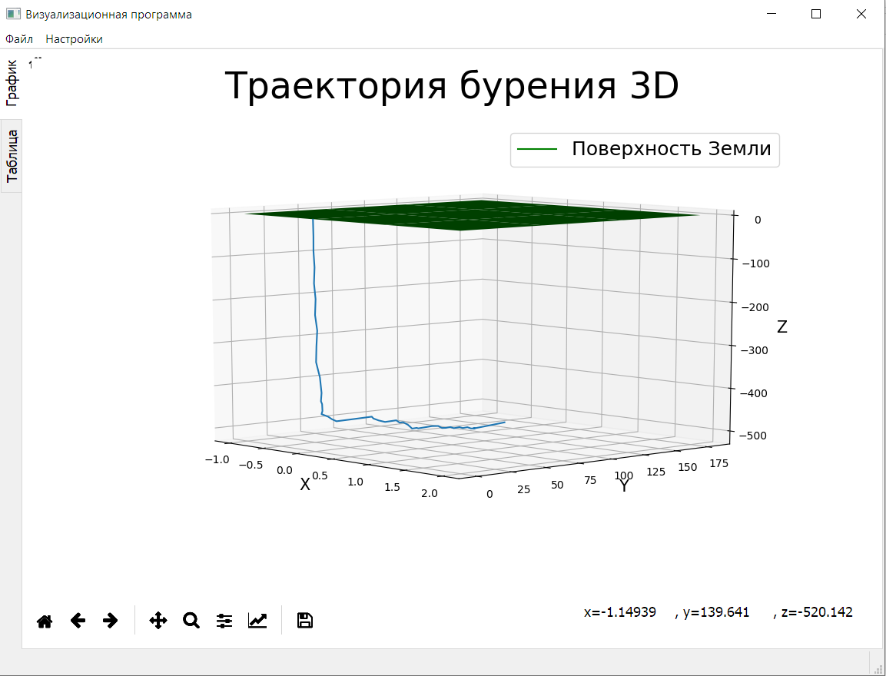
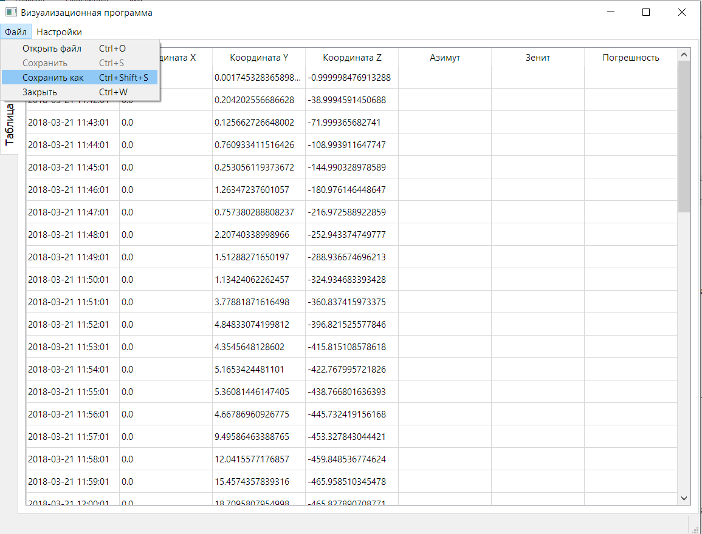
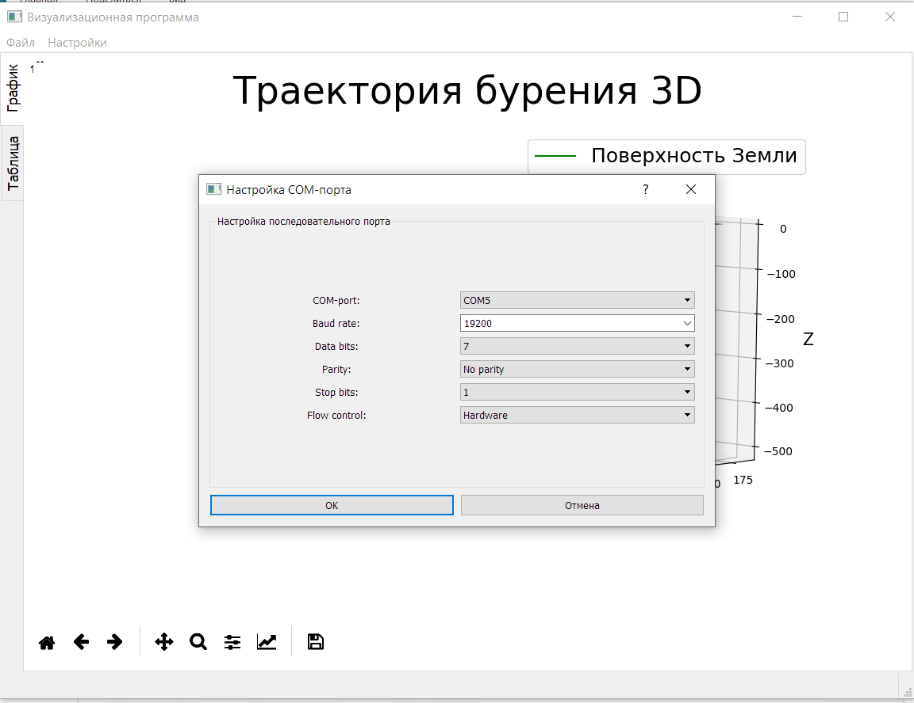

# Serial Port Data Visualizer

A desktop application for communication with low-level software and embedded systems.

The application reads data from a serial (COM) port and visualizes it as a 3D plot.

## Features

- Reading data from a serial port
- Configuring serial port settings
- Real-time 3D data visualization
- Saving data to a file and loading it from a file
- Viewing collected data in a separate table window
- Taking screenshots of the visualization

## Screenshots

### Main Window



### Data Table

All received data is also displayed in a separate table window, accessible via the **Table** button in the left control panel.



### Serial Port Settings



## Getting Started

### Installation

```bash
pip install -r requirements.txt
```

### Running the Application

```bash
python main.py
```